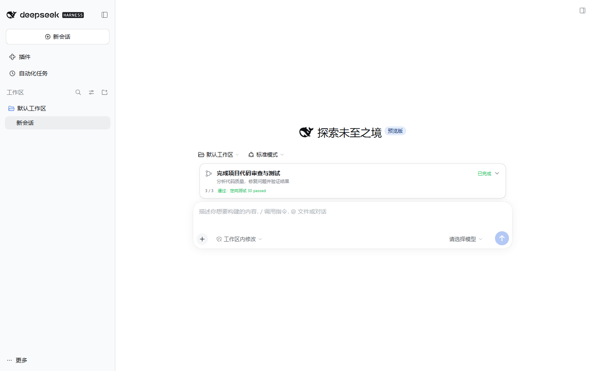
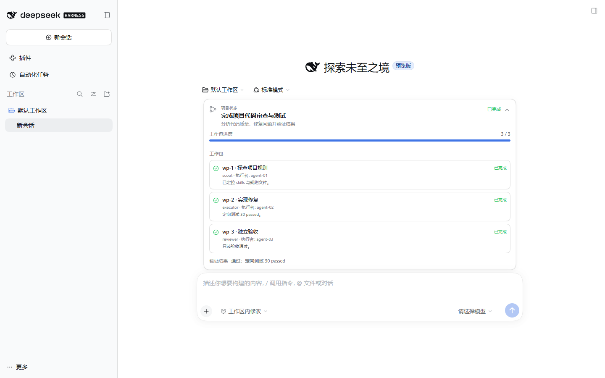

# dsh-project-lead

[](LICENSE)

`dsh-project-lead` is a DeepSeek Harness 0.2.x plugin that turns a top-level
agent into a Project Manager for planning, decomposition, dispatch, acceptance,
and reporting. Delegated children receive executor, reviewer, or scout contracts,
while the plugin records process-wide token usage by `provider/model`.

## Advantages

- **Separated responsibilities:** the PM owns goals, plans, and acceptance;
  Executors implement; Reviewers perform independent read-only checks; Scouts
  gather repository facts without changing files.
- **Scoped prompts:** the PM contract is injected only into the configured PM
  preset. Standard sessions keep their normal tools and behavior.
- **Clear tool boundary:** the optional PM preset keeps `read` / `read_image`,
  removes `write` / `edit`, and has no shell; children switch to Standard for
  code-capable execution.
- **Controlled model routing:** child selection is restricted to exact
  `provider/model` pairs in `allowedModels`. Model notes guide assignment but do
  not grant access.
- **Context and cost control:** independent packages run in parallel; related
  follow-ups can reuse an idle child; the PM can inspect process-wide usage with
  `model_token_usage`.
- **Evidence-based completion:** `started subagent` means accepted for execution,
  not successful. Completion notices carry the result, failure diagnostics, and
  any partial output for acceptance.
- **Repository-native configuration:** the Web Settings page, profile patch,
  bundled role prompts, and custom prompt directory are supported together.

## Requirements

- DeepSeek Harness `>=0.2.1-rc.2 <0.3.0-0`; verified on `0.2.1-rc.2`.
- A profile that mounts `dsh-system-prompt`, `dsh-tools`, `dsh-llm`, and a
  `subagent` delegation tool.
- For child model selection, an enabled `subagent-model-selection-settings`
  allow-list and a preset-scoped delegation tool with
  `modelSelectionSettings: true`. Shipped Web presets provide the required
  scope.

## Installation

Install the plugin in a Web profile:

```sh
dsh plugin --profile web add dsh-project-lead
```

For a local checkout:

```sh
dsh plugin --profile web add link:/absolute/path/to/dsh-project-lead
```

The package's [bundle patch](cordis.patch.yml) mounts the `project-lead` row.
Restart the harness after profile changes when HMR is not enabled.

## Configuration

Use **Settings → 项目编排** for plugin settings, or merge the equivalent entries
from [examples/cordis.patch.yml](examples/cordis.patch.yml) into
`$DSH_HOME/profiles/<profile>/cordis.patch.yml`. A profile patch replaces a
target row's whole `config:` value, so preserve existing values when merging.

### PM preset and tool boundary

Prompt injection alone does not remove tools. The optional PM preset in
[examples/pm-preset.patch.yml](examples/pm-preset.patch.yml) provides the actual
boundary:

- PM sessions keep `read` / `read_image`;
- PM sessions remove `write` / `edit` and do not include `pwsh` / `bash`;
- children use `agentPreset: standard` and retain code tools;
- Standard remains the default preset for small tasks that do not need
  decomposition.

### Plugin configuration

```yaml
- id: project-lead
  config:
    prompts:
      main: compact          # compact | full | guidance | off
      pmPreset: pm           # preset receiving the PM prompt; empty = all
      otherMain: guidance    # other top-level sessions: guidance | off
      childRoles: true
      defaultChildRole: executor
      roleMarker: ROLE
      # dir: /optional/custom/prompt/directory
    subagent:
      provider: glm
      model: glm-4-flash
      reasoningEffort: ""
    modelNotes:
      glm/glm-4.6:
        description: Strong reasoning route.
        strengths: complex reasoning, coding
        weaknesses: slower and pricier
```

| Setting | Default | Meaning |
|---|---|---|
| `prompts.main` | `compact` | `compact`, `full`, legacy lightweight `guidance`, or `off`. `compact` / `full` use the PM contract only for `pmPreset` sessions. |
| `prompts.pmPreset` | `pm` | Preset id receiving the PM contract; empty applies it to every top-level session. |
| `prompts.otherMain` | `guidance` | Prompt for non-PM top-level sessions: `guidance` or `off`. |
| `prompts.childRoles` | `true` | Inject executor/reviewer/scout contracts into child sessions. |
| `prompts.defaultChildRole` | `executor` | Role used when the brief has no role marker. |
| `prompts.roleMarker` | `ROLE` | Prefix parsed from a line such as `ROLE: scout`. |
| `prompts.dir` | bundled | Custom Markdown prompt directory using `00-project-manager.md` through `08-scout.md`; missing files fall back to bundled prompts. |
| `subagent.provider/model` | empty | Default route the PM passes to children; empty values leave route choice to the authorized session. |
| `subagent.reasoningEffort` | empty | Passed only when the selected model advertises that effort. |
| `modelNotes` | `{}` | `provider/model` routing notes with optional `description`, `strengths`, and `weaknesses`; not an authorization list. |

## Quick start

1. Install the plugin and apply the optional PM preset if the top-level session
   must not edit files or run commands.
2. Configure at least one model route and authorize it for children. Its
   `apiKeyEnv` names an environment variable or credential-store key; do not put
   the secret itself in the profile patch.
3. Start a session with the configured PM preset and give it a project task.
   The PM brief should state the goal, constraints, acceptance evidence, and
   independent parts that may be delegated.

Begin each child brief with one of:

```text
ROLE: executor
ROLE: reviewer
ROLE: scout
```

The plugin reads the marker from the child request. Without one,
`defaultChildRole` applies. A `subagent` call returns `started subagent <childId>`
while the child runs; the completion notice carries its result or failure details.

## Runtime behavior

The plugin uses the public `systemPrompt`, `tools`, and `llm/stream` extension
points. It does not patch Harness internals. Each model request is assembled
through the following paths.

### Prompt assembly

For each system-prompt assembly, the plugin checks delegation depth, visible
tools, the active preset projection, and the `project-lead` configuration:

1. A child with delegation depth greater than zero receives the contract selected
   by its `ROLE:` marker. It does not receive the PM contract or instructions to
   delegate again.
2. An agent without a visible `subagent` tool receives no orchestration prompt.
3. `main: off` disables the orchestration section.
4. A top-level session outside `pmPreset` receives `otherMain` (lightweight
   guidance by default) and keeps its preset's tools.
5. A top-level PM session receives `compact` or `full`. `compact` includes the
   PM core, phase checklist, and dispatch convention; `full` also includes the
   intake, planning, review, and status contracts.

The plugin prefers the live `agentPreset` session projection after a runtime
preset switch and falls back to the session header in older compositions.

### Dispatch and child reuse

The PM contract instructs the agent to record work packages, inspect authorized
routes when `list_subagent_models` is visible, write self-contained briefs, launch
independent packages together, and accept results only with evidence.

When both `list_agents` and `send_message` are visible, the PM checks for an idle
continuable child before spawning a related follow-up:

- reuse a same-role, same-project or adjacent-scope child with remaining context
  through `send_message` and a delta brief;
- spawn fresh for a different role or model, unrelated work, high context, fresh
  isolation, or an independent final review;
- use at most two follow-ups or roughly half a child's context by default;
- treat `send_message` as acceptance only and wait for its completion notice;
- a Reviewer that proposed a repair must not perform the fresh final acceptance
  of that repair.

If the control tools are unavailable, the PM falls back to spawning a new child
with a complete brief. Every `subagent` call is asynchronous; start acceptance is
never completion evidence.

### Project status card

The top-level PM can call `project_status_update` to append a compact,
cross-turn project status event. The Web client renders it as a collapsible card
docked above the composer:

- collapsed view: goal or focus, summary, phase, `done/total` progress, running
  child count, verification state, and update time;
- expanded view: work packages with role/owner/evidence, verification, next step,
  and blockers;
- the first update should carry complete state; later updates may send only
  changed fields, while a provided `workPackages` list replaces the previous list;
- only the top-level Project Lead may update the card; child Agents receive an
  error instead of modifying the parent's status;
- the PM prompt uses this card for progress and keeps the final chat response as
  a short delivery summary.

The native Goal owns the objective and lifecycle, the native task card owns the
current turn's executable steps, and this card owns cross-turn work packages,
verification, blockers, and next actions. If the status tool is unavailable, the
prompt falls back to a minimal status report.





### Token accounting

The plugin observes the global `llm/stream` waterfall, including child calls:

- only streams with non-empty `provider` and `model` are recorded;
- multiple usage chunks in one stream use the last chunk, and one usage-bearing
  stream counts as one request;
- the report includes input, output, cache read, cache write, reasoning, and
  request counts;
- `total = input + output + cache read + cache write`; reasoning is a subset of
  output and is not added again;
- rows are grouped by `provider/model` and sorted by computed total usage;
- records cover all sessions and children since the plugin process started and
  reset when the process restarts.

Ask the main agent to call `model_token_usage` to view the report. It is separate
from the Harness per-session token meter.

## Model routing and authorization

Child model selection requires two independent layers.

### Layer 1: available model routes

Configure OpenAI-compatible routes in the Web **Models** page or an `llm-pi-ai`
row. A route declares its provider, model, API endpoint, and `apiKeyEnv`.

```yaml
- id: llm-pi-ai
  config:
    providers:
      glm:
        displayName: Zhipu GLM
        apiKeyEnv: GLM_API_KEY
        api: openai-completions
        baseURL: https://open.bigmodel.cn/api/paas/v4
        models:
          - id: glm-4.6
            name: GLM-4.6
            contextWindow: 200000
```

### Layer 2: allow-list and tool scope

The allow-list accepts exact provider/model pairs:

```yaml
- id: subagent-model-selection-settings
  config:
    enabled: true
    allowedModels:
      - { provider: glm, model: glm-4.6 }
      - { provider: kimi, model: kimi-k2-0711-preview }
```

The live delegation tool must also be inside an agent-preset scope and set:

```yaml
- id: tool-subagent
  config:
    provider: spawn
    toolName: subagent
    modelSelectionSettings: true
```

Both layers are required:

- if the allow-list is disabled or empty, or the tool is outside preset scope,
  `list_subagent_models` is not registered;
- without model selection, the child must not receive `provider`, `model`, or
  `reasoning_effort`; it uses the configured default child route;
- the allow-list controls which exact routes may be selected; it does not create
  providers or replace API-key configuration;
- `modelNotes` affects PM assignment advice only and never grants permission;
- reasoning effort is shown and passed only when the model catalog advertises it.

The shipped Web standard / ptc / cordis presets already provide the scoped
delegation tool, so Web users normally only configure the allow-list. A host-level
row in a direct-agent or headless composition cannot enable this model-selection
feature.

## Child roles

The PM should start each child brief with a role marker:

```text
ROLE: executor
ROLE: reviewer
ROLE: scout
```

- **Executor:** implements, debugs, and verifies one bounded package without
  redefining the goal or spawning another child.
- **Reviewer:** performs a read-only, adversarial review and returns evidence-based
  findings and a verdict; it does not fix the delivery.
- **Scout:** performs read-only reconnaissance of code, dependencies, entry points,
  and tests; it reports facts and evidence without implementing or making product
  decisions.

Children cannot see the main conversation, so each brief must include its goal,
context, scope, non-goals, deliverable, acceptance conditions, and authorized
verification commands.

## Documentation and migration

- [Profile patch example](examples/cordis.patch.yml)
- [PM preset example](examples/pm-preset.patch.yml)
- [Legacy 0.1.x settings format](examples/settings.yaml)
- [中文 README](README.zh.md)

### Migrating from 0.1.x

DeepSeek Harness 0.2.x imports `$DSH_HOME/settings.yaml` once and then renames it
to `settings.yaml.imported`; later edits are ignored. Move configuration to the
profile patch or Settings page. Current row ids are `llm-pi-ai`,
`subagent-model-selection-settings`, `tool-subagent`, and `project-lead`. The old
`subagent-model-selection` id and the former foreground/background delegation
switch are not part of the 0.2.x interface.

## Troubleshooting

- **`list_subagent_models` is missing:** check `enabled`, a non-empty
  `allowedModels`, and `modelSelectionSettings: true` on the preset-scoped row.
- **`standing modelSelectionSettings requires a scoped preset Context`:** move the
  setting into an agent-preset scope, or use the configured child route.
- **A child route is rejected:** verify the exact provider/model is in
  `allowedModels`, the provider advertises the model, and the delegation depth
  limit has not been reached.
- **Only `started subagent ...` appears:** wait for the completion notice; start
  acceptance is not success.
- **`model_token_usage` has no records:** no usage-bearing model stream has
  completed since the plugin loaded.
- **Edits to `settings.yaml` do nothing:** 0.2.x imported it once and renamed it;
  migrate the values to the profile patch.
- **`modelNotes` has no effect:** check the `project-lead` row id, `config:`
  indentation, and reload or restart.

## Testing

```sh
npm test
```

The test script checks client JavaScript syntax, plugin configuration and preset
gating, PM/child prompt selection, role-marker parsing, child-reuse guidance,
status projection and permissions, token accounting, package compatibility, and
the shipped examples.

## License

MIT. See [LICENSE](LICENSE).
